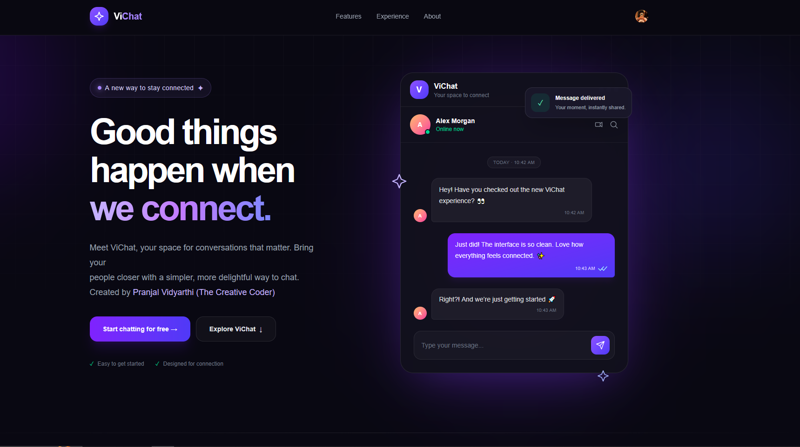
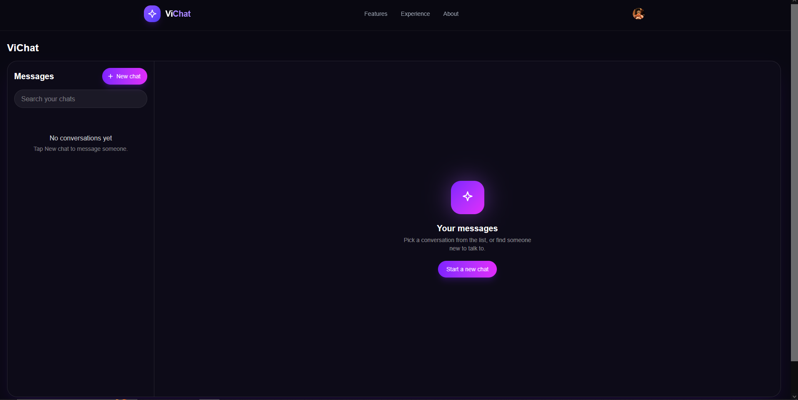
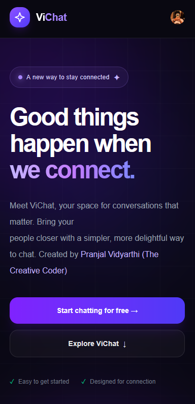
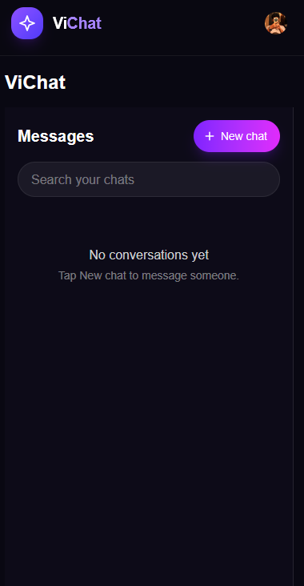

# ViChat 💬

**ViChat** is a real-time messaging web application built with Next.js, TypeScript, Clerk, and Stream Chat. It is designed to make it easy for registered users to discover other users and communicate through one-to-one conversations.

## ✨ Features

- 🔐 **Authentication** — Secure sign-up and sign-in powered by Clerk.
- 💬 **Real-Time Messaging** — Send and receive messages using Stream Chat.
- 👥 **User Discovery** — Search registered users to start conversations.
- 🤝 **Private Conversations** — Start one-to-one chats with other users.
- 🔔 **Unread Messages** — View unread-message indicators in the conversation list.
- 🖼️ **User Profiles** — Display user names and profile pictures.
- 📱 **Responsive Interface** — A chat layout designed for convenient navigation.
- ⚡ **Modern Tech Stack** — Built with Next.js App Router, TypeScript, and Tailwind CSS.

## 🛠️ Tech Stack

| Technology | Purpose |
|---|---|
| [Next.js](https://nextjs.org/) | React framework and server-side API routes |
| [React](https://react.dev/) | User interface |
| [TypeScript](https://www.typescriptlang.org/) | Type safety |
| [Tailwind CSS](https://tailwindcss.com/) | Styling |
| [Clerk](https://clerk.com/) | Authentication and user management |
| [Stream Chat](https://getstream.io/chat/) | Real-time messaging infrastructure |
| [Stream Chat React](https://getstream.io/chat/docs/sdk/react/) | Chat UI components |

## 🚀 Getting Started

Follow these steps to run ViChat locally.

### Prerequisites

Make sure you have:

- [Node.js](https://nodejs.org/) installed.
- npm installed.

- A [Clerk](https://clerk.com/) account.
- A [Stream](https://getstream.io/) account with a Chat application.

### 1. Clone the repository

```bash
git clone https://github.com/pranjalvidyarthi/ViChat.git
cd ViChat
```


### 2. Install dependencies

```bash
npm install
```

### 3. Configure environment variables

Create a `.env.local` file in the project's root directory.

Add the following variables:

```env
NEXT_PUBLIC_CLERK_PUBLISHABLE_KEY=your_clerk_publishable_key
CLERK_SECRET_KEY=your_clerk_secret_key

NEXT_PUBLIC_STREAM_API_KEY=your_stream_api_key
STREAM_API_SECRET=your_stream_api_secret
```

Replace the placeholder values with the credentials from your Clerk and Stream dashboards.

**Security note:** Never commit `.env.local` or expose secret keys in client-side code. Keep `CLERK_SECRET_KEY` and `STREAM_API_SECRET` server-side only.

### 4. Start the development server

```bash
npm run dev
```

Open [http://localhost:3000](http://localhost:3000) in your browser.

## 📁 Project Structure

The main application files are organized approximately as follows:

```text
vichat/
├── app/
│   ├── api/
│   │   ├── chat/
│   │   │   ├── token/
│   │   │   │   └── route.ts
│   │   │   └── create/
│   │   │       └── route.ts
│   │   ├── users/
│   │   │   └── search/
│   │   │       └── route.ts
│   ├── chat/
│   │   ├── page.tsx
│   │   └── ChatClient.tsx
│   ├── components/
│   │   └── navbar.tsx
│   ├── layout.tsx
│   └── page.tsx
├── public/
│   └── vichat-icon.svg
├── .env.local
├── package.json
└── README.md
```

Your actual project may contain additional files or use slightly different folder names.

## 5. Screenshots




## 🔑 How It Works

1. Users sign in or register through Clerk.
2. The application obtains the authenticated user's Clerk ID.
3. The server generates a Stream Chat token for that user.
4. The Stream client connects using the user's identity.
5. Users search for other registered accounts.
6. The server validates the recipient and creates or retrieves a conversation.
7. Stream Chat manages real-time message delivery and conversation updates.

ViChat uses Clerk user IDs as Stream Chat user IDs to keep user identities consistent across both services.


## 🔒 Security

- Authentication is handled by Clerk.
- Sensitive API secrets must remain on the server.
- Protected API routes should validate the authenticated user.
- User-provided recipient IDs must be validated server-side.
- Stream Chat permissions should be configured to prevent unauthorized access to conversations.

## 📄 License

MIT License

Copyright (c) 2026 Pranjal Vidyarthi 

Permission is hereby granted, free of charge, to any person obtaining a copy
of this software and associated documentation files (the "Software"), to deal
in the Software without restriction, including without limitation the rights
to use, copy, modify, merge, publish, distribute, sublicense, and/or sell
copies of the Software, and to permit persons to whom the Software is
furnished to do so, subject to the following conditions:

The above copyright notice and this permission notice shall be included in all
copies or substantial portions of the Software.

THE SOFTWARE IS PROVIDED "AS IS", WITHOUT WARRANTY OF ANY KIND, EXPRESS OR
IMPLIED, INCLUDING BUT NOT LIMITED TO THE WARRANTIES OF MERCHANTABILITY,
FITNESS FOR A PARTICULAR PURPOSE AND NONINFRINGEMENT. IN NO EVENT SHALL THE
AUTHORS OR COPYRIGHT HOLDERS BE LIABLE FOR ANY CLAIM, DAMAGES OR OTHER
LIABILITY, WHETHER IN AN ACTION OF CONTRACT, TORT OR OTHERWISE, ARISING FROM,
OUT OF OR IN CONNECTION WITH THE SOFTWARE OR THE USE OR OTHER DEALINGS IN THE
SOFTWARE.
